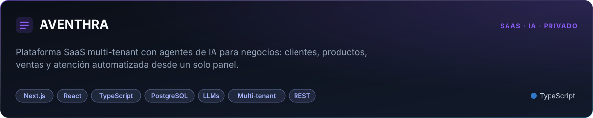
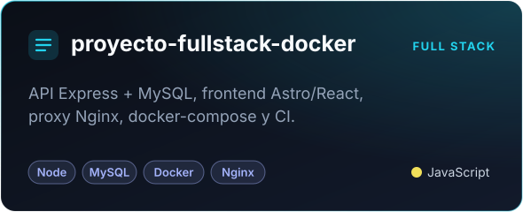
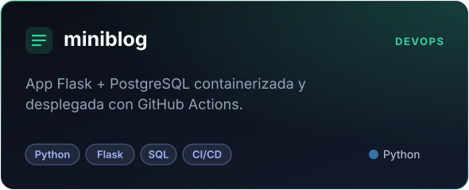
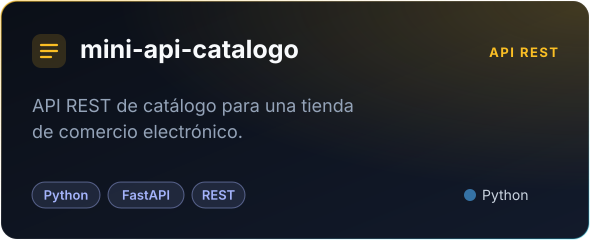
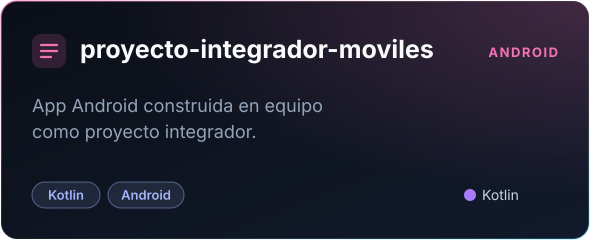
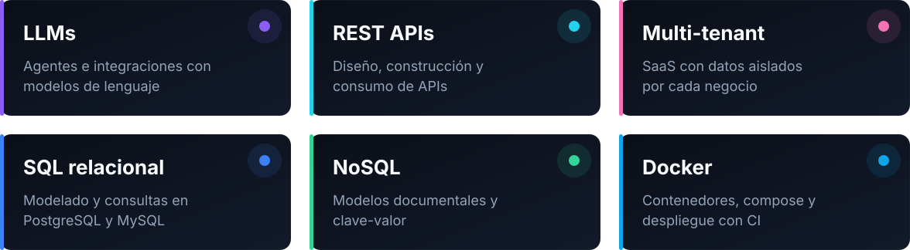

  

  
  

  

 

Soy **Yhojan Andrés Caro González**, desarrollador full stack de Medellín 🇨🇴.

- 🚀 Fundé **[AVENTHRA](https://aventhra.online)**, un SaaS multi-tenant con agentes de IA que ayuda a los negocios a vender y atender clientes en automático.
- 🎓 Me formo como **Tecnólogo en Análisis y Desarrollo de Software (ADSO)** en el **SENA**.
- 🧠 Me gusta llevar una idea de principio a fin: producto, base de datos, backend, frontend y despliegue.
- 🤝 Abierto a colaborar en proyectos de IA, SaaS y producto.

 

  

  
  

  
  

 

  

  

 

  

  
  

