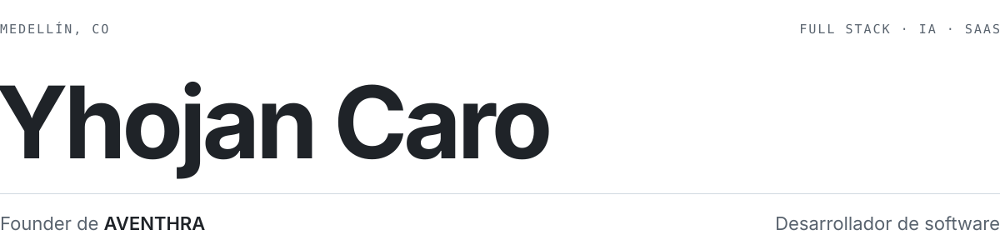

<picture>
  <source media="(prefers-color-scheme: dark)" srcset="./assets/banner-dark.svg">
  
</picture>

 

Construyo **[AVENTHRA](https://aventhra.online)**, un SaaS multi-tenant con agentes de IA que atiende clientes y apoya las ventas de los negocios. Me gusta llevar una idea completa: producto, base de datos, backend, frontend y despliegue.

Me formo como Tecnólogo en Análisis y Desarrollo de Software en el SENA.

 

**Ahora**

[AVENTHRA](https://aventhra.online) — Next.js, TypeScript, PostgreSQL, LLMs, arquitectura multi-tenant.

**Proyectos**

[proyecto-fullstack-docker](https://github.com/YhojanCaro19/proyecto-fullstack-docker) — API Express + MySQL, frontend Astro/React, Nginx, docker-compose y CI  
[miniblog](https://github.com/YhojanCaro19/miniblog) — Flask + PostgreSQL en contenedores, desplegado con GitHub Actions  
[mini-api-catalogo](https://github.com/YhojanCaro19/mini-api-catalogo) — API REST de catálogo con FastAPI  
[proyecto-integrador-moviles-g6](https://github.com/YhojanCaro19/proyecto-integrador-moviles-g6) — App Android en Kotlin, en equipo

**Stack**

<picture><source media="(prefers-color-scheme: dark)" srcset="https://cdn.simpleicons.org/javascript/8b949e"></picture>&nbsp;&nbsp;&nbsp;<picture><source media="(prefers-color-scheme: dark)" srcset="https://cdn.simpleicons.org/typescript/8b949e"></picture>&nbsp;&nbsp;&nbsp;<picture><source media="(prefers-color-scheme: dark)" srcset="https://cdn.simpleicons.org/react/8b949e"></picture>&nbsp;&nbsp;&nbsp;<picture><source media="(prefers-color-scheme: dark)" srcset="https://cdn.simpleicons.org/nextdotjs/8b949e"></picture>&nbsp;&nbsp;&nbsp;<picture><source media="(prefers-color-scheme: dark)" srcset="https://cdn.simpleicons.org/nodedotjs/8b949e"></picture>&nbsp;&nbsp;&nbsp;<picture><source media="(prefers-color-scheme: dark)" srcset="https://cdn.simpleicons.org/python/8b949e"></picture>&nbsp;&nbsp;&nbsp;<picture><source media="(prefers-color-scheme: dark)" srcset="https://cdn.simpleicons.org/openjdk/8b949e"></picture>&nbsp;&nbsp;&nbsp;<picture><source media="(prefers-color-scheme: dark)" srcset="https://cdn.simpleicons.org/kotlin/8b949e"></picture>&nbsp;&nbsp;&nbsp;<picture><source media="(prefers-color-scheme: dark)" srcset="https://cdn.simpleicons.org/postgresql/8b949e"></picture>&nbsp;&nbsp;&nbsp;<picture><source media="(prefers-color-scheme: dark)" srcset="https://cdn.simpleicons.org/mongodb/8b949e"></picture>&nbsp;&nbsp;&nbsp;<picture><source media="(prefers-color-scheme: dark)" srcset="https://cdn.simpleicons.org/docker/8b949e"></picture>&nbsp;&nbsp;&nbsp;<picture><source media="(prefers-color-scheme: dark)" srcset="https://cdn.simpleicons.org/anthropic/8b949e"></picture>

JavaScript · TypeScript · React · Next.js · Node.js · Python · Java · Kotlin · SQL · NoSQL · LLMs · REST · Multi-tenant · Docker

 

[aventhra.online](https://aventhra.online) · [caroyhojan@gmail.com](mailto:caroyhojan@gmail.com)
