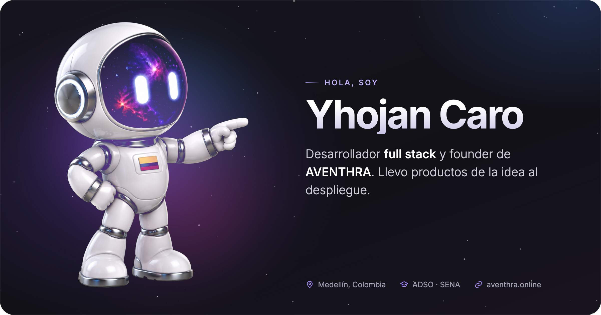

### Con lo que trabajo

<table>
<tr><td width="50%" valign="top"><b>Lenguajes</b>   JavaScript · TypeScript · Python · Java · Kotlin PHP · HTML · CSS · SQL</td><td width="50%" valign="top"><b>Frontend</b>   React · Next.js · Astro Tailwind CSS · shadcn/ui</td></tr>
<tr><td width="50%" valign="top"><b>Backend</b>   Node.js · Express · FastAPI · Flask REST APIs · Zod</td><td width="50%" valign="top"><b>Bases de datos</b>   PostgreSQL · MySQL · Supabase Redis (NoSQL)</td></tr>
<tr><td width="50%" valign="top"><b>Móvil</b>   Android · Kotlin Jetpack Compose</td><td width="50%" valign="top"><b>DevOps</b>   Docker · Kubernetes · Nginx GitHub Actions · Git · Vercel</td></tr>
<tr><td colspan="2"><b>Arquitectura</b> &nbsp;·&nbsp; Multi-tenant · APIs REST · LLMs</td></tr>
</table>

### Algunos proyectos

- **[AVENTHRA](https://aventhra.online)** — mi plataforma. Next.js, TypeScript, PostgreSQL, multi-tenant. *(repo privado)*
- **[proyecto-fullstack-docker](https://github.com/YhojanCaro19/proyecto-fullstack-docker)** — API Express + MySQL, frontend Astro/React, Nginx, docker-compose y CI.
- **[miniblog](https://github.com/YhojanCaro19/miniblog)** — Flask + PostgreSQL en contenedores, desplegado con GitHub Actions.
- **[mini-api-catalogo](https://github.com/YhojanCaro19/mini-api-catalogo)** — API REST de catálogo con FastAPI.
- **[proyecto-integrador-moviles-g6](https://github.com/YhojanCaro19/proyecto-integrador-moviles-g6)** — app Android en Kotlin, en equipo.
